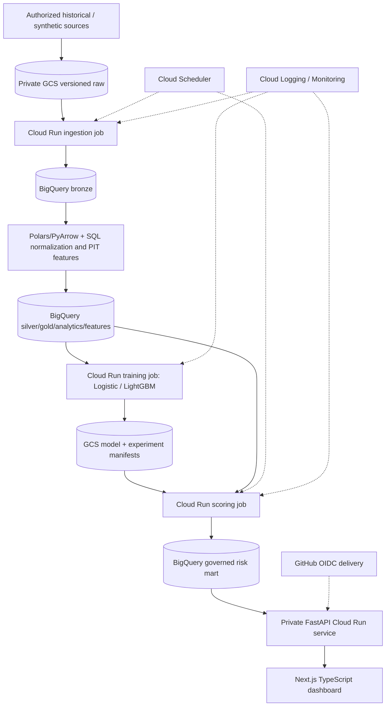

# Architecture

## Implemented local slice

```mermaid
flowchart LR
  G[Synthetic generator or synthetic JSONL file] --> I[Staged intake: schema, identity, revision, watermark]
  I --> R[(Immutable event release + quality manifest)]
  R --> F[Point-in-time features + mature renewal labels]
  F --> Q[(Immutable CSV / typed Parquet feature release)]
  Q --> T[Train-only Logistic Regression + bounded LightGBM candidates]
  T --> E[Validation-only selection, then frozen test evaluation]
  E --> M[(Immutable selected model + source lineage)]
  E --> P[Atomic publication]
  M --> P
  P --> S[(SQLite active release + features + scores + successful run)]
  S --> A[Typed read-only FastAPI workspace]
  S --> O[Read-only System inspection + model-byte checksum]
  M --> O
  O --> A
  A --> X[Same-origin allowlisted proxy]
  X --> U[Next.js analyst workspace]
```

`events.py` owns event schema, local intake, immutable raw source releases, quality reports and
point-in-time feature derivation. `data.py` owns the earlier snapshot schema/intake;
`training.py` owns train-only model fitting and validation-only candidate selection;
`pipeline.py` coordinates model selection, artifacts and lineage; `storage.py` owns
publication transactions. `serving.py` reads consistent workspace views and `runs.py`
records actual attempts; `api.py` serves bounded results. `cli.py` exposes generation,
ingestion, replay and the one-command demo; `apps/web/` provides Next.js/TypeScript.
Shared Python stays in `src/retentionops/`.

`system_status.py` inspects publication state and readable run history without creating a
database. It verifies the selected artifact's checksum without loading executable model
serialization. Publication reconciliation and artifact integrity are separate status fields.
The Next.js root and `/system` consume this independent endpoint; retention Overview lives
at `/overview` and the other analyst views keep their named routes.

Synthetic event intake copies the input into staging, validates all rows and revisions against
the declared completeness watermark, writes deterministic provenance, then renames the
release directory atomically. Replay verifies the raw hash and quality evidence before
derivation. Feature Parquet and model artifacts are immutable and content-addressed. SQLite
commits manifest, feature snapshots, predictions, the active pointer and successful run
state together. Failed attempts remain observable without replacing the active release.
A workspace request reads the active manifest and views within one read transaction,
preventing mixed model releases. Customer detail requests pin the displayed model version.
Every model entrypoint records an attempt, and conflicting replays of features or scores
reject before changing the active release. Model status exposes the selected family,
candidate, configuration and validation AP for Logistic Regression and LightGBM releases.

Local constraints: the event adapter accepts only the synthetic event schema and IDs; it is
not a real-data/KKBox source adapter. One pipeline writer per root; CSV intake materializes in
memory; SQLite serves small demos; no cloud scheduler or GCS/BigQuery integration exists. The
legacy `all` command still uses simulated snapshot features. Model family and LightGBM grid
selection use validation average precision; test is evaluated after freeze. The local
manifest carries candidate results, selected parameters and dependency/source/model hashes.
Snapshot labels are generated draws; event labels describe simulated renewal opportunities.
An external source needs independent rights, schema, eligibility, label and watermark
verification. The web proxy uses a fixed server-side backend destination and allowlisted
paths. Local ports bind to loopback; production authentication remains open. The data/model
view shows local lineage and attempts; cloud infrastructure telemetry needs actual resources
and monitoring evidence. Cloud resources remain planned, not provisioned.
The System response identifies local SQLite, simulated source/label truth, cloud not connected
and authentication not configured. Risk query state is encoded in the URL for replayable
navigation; backend filters remain validated and bounded.

## Target cloud architecture (planned)

No resources in this diagram are claimed to exist. Region, account/project, billing alerts,
IAM, API enablement and teardown need a verified plan and owner approval before creation.
Batch-first serving decouples analyst requests from expensive model execution. BigQuery
queries must use governed views, partition predicates and maximum bytes billed.
