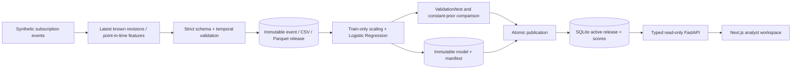
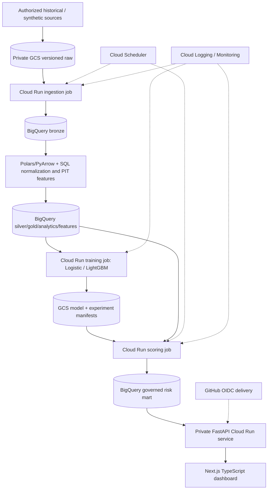

# Architecture

## Implemented local slice

`events.py` owns bitemporal event features; `data.py` owns snapshot schema/intake; `training.py` owns the fixed evaluation protocol;
`pipeline.py` coordinates artifacts and lineage; `storage.py` owns publication transactions;
`serving.py` reads consistent workspace views; `runs.py` records actual attempts;
`api.py` serves bounded results and `apps/web/` provides Next.js/TypeScript. Shared Python is in
`src/retentionops/`; separate cloud job entrypoints when those adapters are built.

Data is generated at customer × cutoff grain. The entire source is validated before a raw
release becomes visible. Models are written through a staging directory then renamed.
SQLite commits manifest, features, predictions, active pointer and successful run state together. A request reads the
active manifest and scores within one read transaction, preventing mixed model releases.

Local constraints: one pipeline writer per root; CSV materializes in memory; SQLite serves
small demos; no public authentication; no cloud scheduler; features are
computed from simulated events on the `events` path. The legacy `all` path still simulates
feature values directly. Source completeness is defined by the synthetic generator; an
external source needs independent rights/schema/watermark verification.

## Target cloud architecture (planned)

No resources in this diagram are claimed to exist. Region, account/project, billing alerts,
IAM, API enablement and teardown need a verified plan and owner approval before creation.
Batch-first serving decouples analyst requests from expensive model execution. BigQuery
queries must use governed views, partition predicates and maximum bytes billed.
