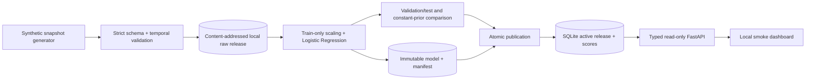
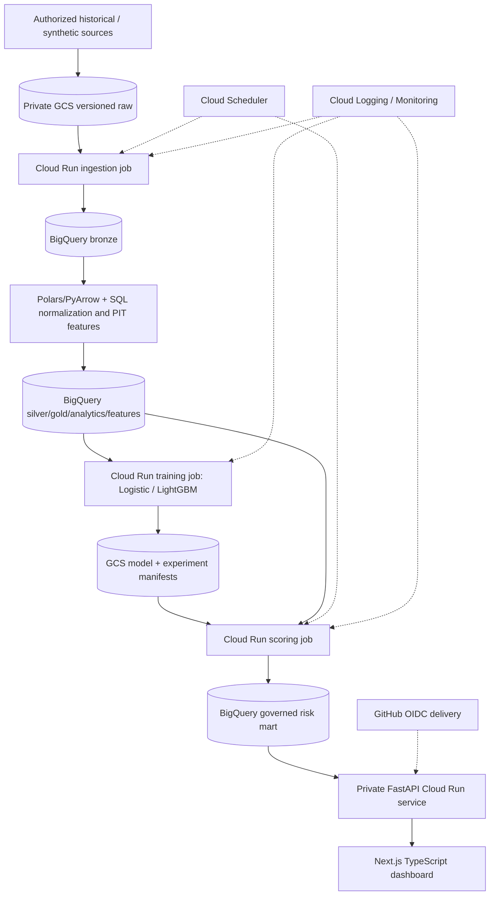

# Architecture

## Implemented local slice

`data.py` owns source schema/intake; `training.py` owns the fixed evaluation protocol;
`pipeline.py` coordinates artifacts and lineage; `storage.py` owns publication transactions;
`api.py` serves bounded results; `cli.py` explicitly runs work. Shared code is in
`src/retentionops/`; introduce `apps/web/` and separate job entrypoints as those are built.

Data is generated at customer × cutoff grain. The entire source is validated before a raw
release becomes visible. Models are written through a staging directory then renamed.
SQLite commits manifest, predictions and the active pointer together. A request reads the
active manifest and scores within one read transaction, preventing mixed model releases.

Local constraints: one pipeline writer per root; CSV materializes in memory; SQLite serves
small demos; no public authentication; no cloud scheduler; feature values are simulated,
not computed from raw subscription/activity events. Provenance fields are checked but
cannot independently prove that an external aggregate was generated correctly.

## Target cloud architecture (planned)

No resources in this diagram are claimed to exist. Region, account/project, billing alerts,
IAM, API enablement and teardown need a verified plan and owner approval before creation.
Batch-first serving decouples analyst requests from expensive model execution. BigQuery
queries must use governed views, partition predicates and maximum bytes billed.
