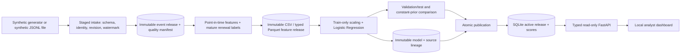
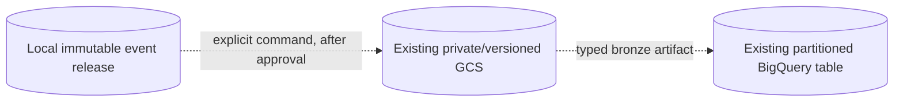
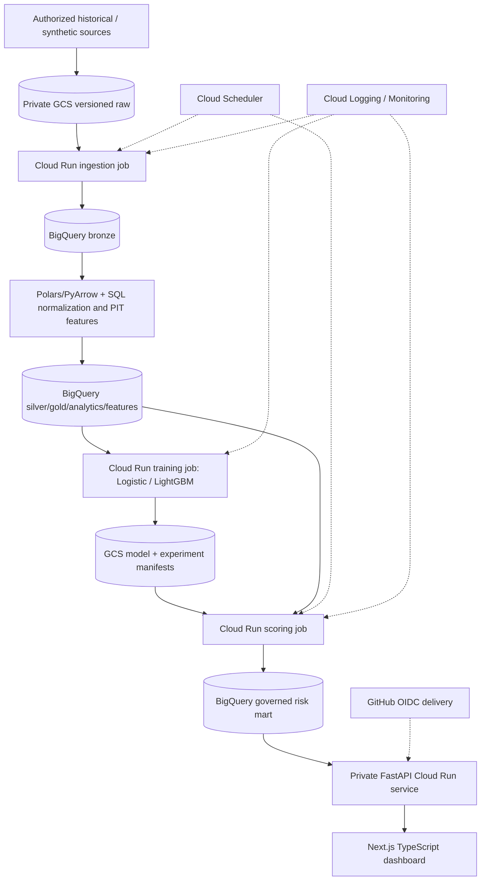

# Architecture

## Implemented local slice

`events.py` owns event schema, local intake, immutable raw source releases, quality reports and
point-in-time feature derivation. `data.py` owns the earlier snapshot schema/intake;
`training.py` owns the fixed evaluation protocol; `pipeline.py` coordinates artifacts and
lineage; `storage.py` owns publication transactions; `api.py` serves bounded results; `cli.py`
exposes generation, ingestion, replay, and the one-command demo. Shared code is in
`src/retentionops/`.

Synthetic event intake copies the input into staging, validates all rows and revisions against
the declared completeness watermark, writes deterministic provenance, then renames the
release directory atomically. Replay verifies the raw hash and quality evidence before
derivation. Feature Parquet and model artifacts are immutable and content-addressed. SQLite
commits manifest, predictions and the active pointer together. A request reads the active
manifest and scores within one read transaction, preventing mixed model releases.

Local constraints: the event adapter accepts only the synthetic event schema and IDs; it is
not a real-data/KKBox source adapter. One pipeline writer per root; CSV intake materializes in
memory; SQLite serves small demos; no cloud scheduler or service integration has been verified.
The legacy `all` command still uses simulated snapshot features. An explicit, optional
`publish-gcp` adapter uploads validated event releases to existing GCS and BigQuery resources.
It uses content-addressed object names, generation preconditions, a typed bronze schema,
idempotent load-job IDs and streamed, field-by-field row/hash/key/lineage reconciliation against
the validated local release. Offline tests use fakes; the adapter has not been run against
Google Cloud. Cloud resources remain planned, not provisioned.

## Target cloud architecture (planned)

No resources in this diagram are claimed to exist. Region, account/project, billing alerts,
IAM, API enablement and teardown need a verified plan and owner approval before creation.
Batch-first serving decouples analyst requests from expensive model execution. BigQuery
queries must use governed views, partition predicates and maximum bytes billed.
